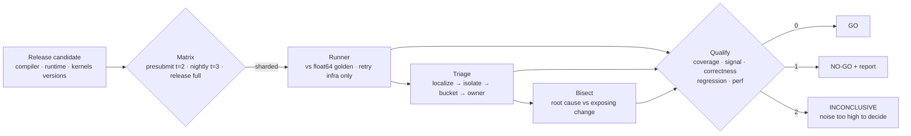

# inference-release-integration

> **Moved.** This project now lives in [inference-qa-lab/inference-release-integration](https://github.com/su0xpj-bastion/inference-qa-lab/tree/main/inference-release-integration), where it is maintained and tested. This repository is archived and read-only.

A Release Integration Testing (RIT) harness for an AI inference core. It takes a set of integrated component versions and returns a **GO / NO-GO / INCONCLUSIVE** decision with evidence. When the answer is NO-GO, it explains why: which layer, which kernel, which tensor, the minimal trigger, an owner, and a bisect verdict.

Feature teams own feature qualification. This harness covers what falls between their suites. Each seeded defect below passes the owning team's unit tests ([`test_component_suites.py`](tests/unit/test_component_suites.py)), and the release is still broken.



## The system under test

`corestack/` is a small inference stack with real layer boundaries: model graphs, a **compiler** (fusion, scheduling, SRAM memory planning), a **runtime** (slot-addressed SRAM, async input prefetch, a device cycle model), versioned **kernels** (fp32/fp16), and a float64 **golden reference** that shares no code with the path under test. SRAM is modelled literally, so a planner bug silently corrupts memory the same way it would on hardware.

[`history.json`](corestack/history.json) is a ten-commit component history with three seeded cross-stack defects:

| | Introduced | Only fails when | Why each team's suite missed it |
|---|---|---|---|
| **B1** | kernels 2.1, fp16 fused-attention fast path that skips max-subtraction | compiler fusion **on** × fp16 × un-tempered logits | The kernel test uses realistic logits. The compiler test is structural. |
| **B2** | compiler 3.2, planner computes lifetime from *first* use | SRAM pressure forces buffer reuse (large shapes) | The planner suite runs small shapes, where nothing is reused. |
| **B3** | runtime 2.4, prefetch hazard check only looks at `inputs[0]` | **latent** until compiler 3.3 reorders projections | The runtime suite was green, and so was every commit until an unrelated compiler change. |

## What the harness produces for `2026.11-rc1`

From [`docs/sample-reports/2026.11-rc1.md`](docs/sample-reports/2026.11-rc1.md):

| Cases | Layer | Diagnosis | Where | Minimal trigger | Bisect |
|---|---|---|---|---|---|
| 72 | runtime | stale prefetched read (RAW hazard) | `matmul_t` reading `k` | async_prefetch | compiler 3.3: **exposing change; latent defect in runtime** |
| 6 | kernels | non-finite output | `fused_attention` writing `ctx` | fused_attention, fp16 | kernels 2.1: **root cause** |
| 2 | compiler | input clobbered in SRAM after write (buffer aliasing) | `add` reading `x` | shape ≥ large | compiler 3.2: **root cause** |

The release has 80 red cases. Triage turns them into 3 tickets with owners, and the decision is **NO-GO**. `2026.11-rc2` contains the three fixes and comes back **GO**, with device cycles down about 10% (geomean ×0.901) from prefetch and fusion.

## How it works

| Stage | Technique | Why |
|---|---|---|
| **Matrix** ([`matrix.py`](rit/matrix.py)) | Greedy t-wise covering arrays plus risk tiers (layers crossed by enabled features, fp16, memory pressure). Stable hash sharding. | 192 cases is affordable at release time, but not on every PR. |
| **Run** ([`runner.py`](rit/runner.py)) | Compares each output against a float64 golden with per-dtype tolerance. Retries `DeviceTimeout` only. | Retrying a product failure hides real bugs, so the retry is the flake signal. |
| **Localize** ([`triage.py`](rit/triage.py)) | Re-runs the case with a device trace and diffs every tensor read and written against the golden. Takes the first divergence. | A bad read whose producer wrote the right value is a memory hazard. A bad write from correct inputs is a kernel bug. |
| **Isolate** | Drops one feature, dtype or shape at a time. | Gives the owner a minimal repro to run in their own suite. |
| **Bucket** | Groups by localization signature, not error text. | 72 cases from one bug should read as one ticket. |
| **Bisect** ([`bisect.py`](rit/bisect.py)) | Binary search over the component history, then compares the first bad commit's component with the localized layer. | git-bisect blames whichever commit turned the test red, and for B3 that's the wrong team. |
| **Qualify** ([`qualify.py`](rit/qualify.py)) | Five gates; INCONCLUSIVE when P0 coverage is incomplete or infra/flake noise exceeds 2%. | A green run on noisy infra isn't evidence of quality. |

### Cost vs detection

The table is pinned by `test_detection_by_mode`, so it can't drift from the code.

| Mode | Cases | B1 | B2 | B3 | Runs on |
|---|---|---|---|---|---|
| presubmit (pairwise) | 15 | ✅ | ❌ at rc1 | ✅ | every PR |
| nightly (3-way) | 24 | ✅ | ✅ at the commit that introduced it, ❌ at rc1 | ✅ | nightly, release branch |
| release (full) | 192 | ✅ | ✅ | ✅ | release candidates |

At rc1, B2 shows up in only 2 of 192 cases. Only the full matrix catches it there. That's why the release candidate always gets the full matrix, even after a green nightly.

## Run it

```bash
python3 -m venv .venv && .venv/bin/pip install -r requirements.txt
.venv/bin/python -m pytest                                    # 41 tests, ~25s
.venv/bin/python -m rit run --commit 2026.11-rc1 --mode release --out results/rc1.jsonl
.venv/bin/python -m rit triage results/rc1.jsonl
.venv/bin/python -m rit bisect --case attention/small/fp32/async_prefetch --good 2026.10 --bad 2026.11-rc1
.venv/bin/python -m rit qualify --release 2026.11-rc1 --baseline-release 2026.10 --results results/rc1.jsonl --out reports/rc1.md
```

`qualify` exits with 0 for GO, 1 for NO-GO and 2 for INCONCLUSIVE, so a CI step can gate on it directly.

## CI

- [`ci.yml`](.github/workflows/ci.yml): runs on every PR. Harness tests, plus presubmit qualification of the head of main, with the report in the job summary.
- [`release-qualification.yml`](.github/workflows/release-qualification.yml): nightly 3-way run, or a manual full-matrix run against any candidate. Three shards with `fail-fast: false`, then one qualify job that merges the shards and posts the GO/NO-GO report as the job summary and an artifact.

## Layout

```
corestack/   simulated inference core: graph + golden, compiler, runtime + device, kernels, component history
rit/         harness: matrix, runner, triage, bisect, qualify, report, CLI; owners.json, known_issues.json
tests/       unit/ (harness + component-team suites)  integration/ (end-to-end qualification of rc1/rc2)
docs/        QUALIFICATION_STRATEGY.md · TRIAGE_PLAYBOOK.md · sample-reports/
```

## Where this stops

- The stack is a simulation. The harness's interfaces (component versions in, results JSONL, bucket and owner routing, gate exit codes) are the parts meant to transfer to a real stack. The physics are not.
- Localization depends on a device trace that captures every tensor. On real hardware that means a debug build or tensor-dump hooks, and the cost is a debug re-run of only the failing cases, never the whole matrix.
- The performance gate uses a deterministic cycle model, so it never flakes. Real-hardware performance needs repeated runs and a noise model before a ±5% gate is meaningful.
